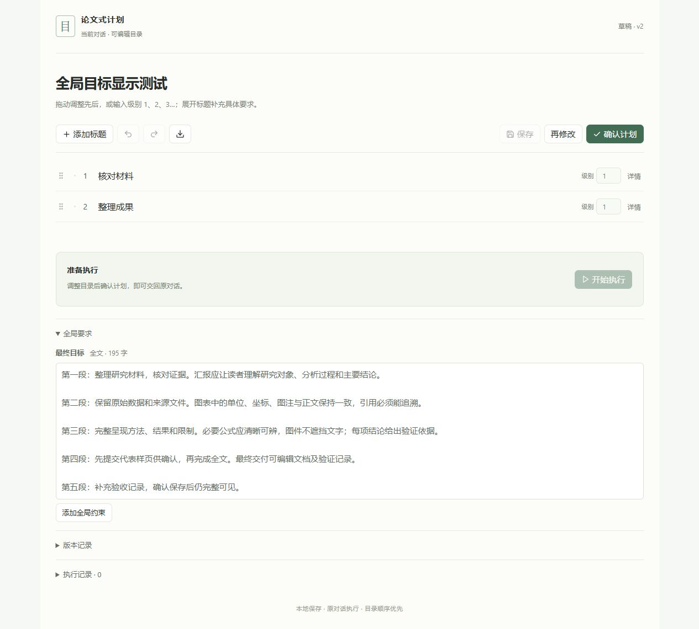

# 论文式计划：使用说明

适用版本：Paper Plan 2.0.1，Windows 本地 Codex 对话。

这个插件把最终计划显示成右侧可编辑目录。你可以改标题、移动章节、补充要求，再让 Codex 按确认版本在原对话中执行。“论文式”指多级标题组织，不要求每份计划都写成引言、方法、结果。

## 1. 安装与首次信任

1. 在 [最新发布页](https://github.com/mimiaozhao/paper-plan/releases/latest) 下载名称以 `-windows.zip` 结尾的安装包。`-source.zip` 是开发源码；GitHub 自动生成的 “Source code” 归档不等于可直接安装的包。
2. 完整解压到固定文件夹，例如 `C:\Tools\paper-plan`。不要直接在 ZIP 内运行，也不要安装后移动目录。
3. 双击 `Install.cmd`。安装器检测 Python 3.11+，建立独立环境，联网安装依赖并注册插件。界面已经构建好，普通使用不需要 Node.js。
4. 在 Codex 的插件管理中确认“论文式计划”已启用。若当前窗口还未加载，重新加载插件或重启 Codex。
5. 在 Codex 输入 `/hooks`，按宿主界面审阅并信任插件的 `UserPromptSubmit`、`Stop`、`Interrupt` 三项钩子。插件无法代替你完成信任；变更后的钩子可能需要重新审阅。参见 [官方 Hooks 文档](https://learn.chatgpt.com/docs/hooks)。

环境要求：Windows 10/11、支持插件与 Hooks 的 Codex、Python 3.11+。安装器优先查找可用的 Codex 内置或系统 Python；首次下载 Python 依赖需要联网。本版在 Windows/Python 3.12 环境验证，未验证 macOS、Linux 和云端对话。

安装完成后不必单独输入本地面板地址。正式计划生成时，插件会使用当前对话的专属地址。

## 2. 第一次使用

1. 在 Codex 打开一个本地对话，手动切到**计划模式**。
2. 描述任务，例如：

   > 帮我整理一份研究汇报。先问我受众、时间和现有材料，需求明确后再给完整计划。

3. 正常回答 Codex 的问题。澄清、讨论和普通回复不会生成计划版本。
4. 等完整正式计划生成并结束本轮回复，右侧会显示对应的多级目录。
5. 在右侧修改目录和要求，等待自动保存完成。
6. 点击**确认计划**，手动把同一对话切回**执行模式**，再点**开始执行**。
7. 在左侧查看工作过程，在右侧展开节点查看逐项结果和验证依据。

流程：计划模式讨论 → 完整目录 → 编辑 → 确认 → 手动切回执行模式 → 开始执行。

“确认计划”只固定这份版本；“开始执行”才会向原对话投递执行请求。收到请求后 Codex 还要核对模式、版本并领取，因此“已排队”不等于“执行中”。

## 3. 编辑目录

| 想做什么 | 操作 |
| --- | --- |
| 修改标题 | 直接点击标题文字编辑 |
| 修改同级顺序 | 拖动标题左侧把手，依据插入线放到目标前后 |
| 改变上下级关系 | 拖到另一标题内，或编辑右侧“级别”数字 |
| 手动输入级别 | 输入 `1`、`2`、`3` 等整数；Enter 或离开输入框应用，Esc 取消 |
| 添加任务 | 顶部“添加标题”，或展开详情后添加同级、子级 |
| 修改具体要求 | 点击“详情”，编辑具体要求、预期产出和验收条件 |
| 折叠子目录 | 点击标题左侧箭头；折叠不改变计划版本 |
| 撤销或重做 | 使用顶部撤销、重做按钮；当前编辑历史不跨页面刷新保留 |
| 键盘移动 | 聚焦拖动把手，按 Alt＋↑/↓ 移动；Alt＋→ 缩进，Alt＋← 取消缩进 |

级别是层次深度，编号由目录自动计算。例如“级别 2”的标题可能显示为 `1.1` 或 `2.3`；不要在级别框输入 `1.1`。没有合适父标题时，界面会提示不能移动，不会制造不存在的层级。

移动父标题时会携带整个子树，不能移入自己的后代。父标题负责组织阶段，父标题的要求对子项生效；如果父标题本身也有独立工作，应把这项工作写成子任务。

编辑后会自动保存，也可以点击“保存”。标题、顺序、层级和要求的修改会影响版本；选中、折叠和展开只改变界面。保存过程中可以继续输入，刷新前请等保存完成。

## 4. 全局目标与约束

展开目录下方的**全局要求**：

- **最终目标**：作用于整份计划，可以写多段文字和列表。
- **约束**：用于所有任务都需遵守的要求，如格式、范围、不可修改的文件等；可点击“添加全局约束”。

2.0.1 起，目标和约束框会按全文自动增高，目标旁显示全文字数。旧版输入框高度较小，后续段落可能藏在框内滚动区，并不代表只保存了第一段。

自动捕获时，总标题之后、首个任务标题之前的正文整体作为全局目标；任务标题下面的正文属于该节点。想让一条要求作用于整份计划，可以在讨论时明确说明，或在面板“全局要求”里补充，保存后重新确认。

下图使用的是测试内容，展示多段目标完整展开的效果：

## 5. 让 Codex 再梳理一遍

如果你已经改好部分目录，但希望 Codex 进一步提问和整理：

1. 点击**再修改**，可选填写本轮重点，例如“帮我找出缺失的论证，重新安排顺序”。
2. 手动将当前对话切到**计划模式**。
3. 点击**已切到计划模式，发送提问**。面板会先保存当前修改，再把这个版本交回同一对话。
4. 在左侧回答 Codex 的问题。需求明确后，Codex 才生成完整新计划。
5. 检查新目录，再次确认后才执行。

发送按钮本身不能改变 Codex 模式。再修改不要求先确认执行，也不会自动开始任务。问答期间可以继续编辑；如果目录在生成过程中发生变化，新计划会保留为待比较候选。

候选区域提供“比较目录”“采用此计划”“保留当前版本”。采用前请同时核对左侧完整计划中的全局要求；当前比较视图主要显示目录和节点内容。若你要停止这次梳理，点击“取消再修改”，当前目录保留。

## 6. 执行、停止与版本

- 执行使用你确认的精确快照，默认从目录上方向下工作；必要调序需要说明原因并记录。
- 叶节点显示待执行、执行中、完成、失败或中断。父节点汇总子项；展开详情可查看实际产出和验证依据。
- 请求排队到执行结束期间，内容和结构锁定，仍可展开查看。
- 尚未领取的请求可以点击“取消请求并解锁”。正在执行时，使用 Codex 原生停止按钮；收到中断状态后解锁。
- 若显示“等待切换执行模式”，先手动切换，再点击“已切换，重试”。
- 修改目标、删除任务或改变验收条件后，应重新确认；不能让正在运行的任务悄悄改用另一份计划。

不同对话有各自的目录，不要把一个对话的面板地址或手动继续指令复制到另一个对话执行。

## 7. 常见问题

| 现象 | 检查与处理 |
| --- | --- |
| 右侧没有打开 | 确认插件已启用、三项钩子已信任，当前是计划模式，并等待完整正式计划生成。澄清回复不会触发。 |
| 面板打开但没有目录 | 查看上方同步错误；核对地址中的 `thread=` 是否属于当前对话。聊天中的完整计划仍保留。 |
| 看起来只有第一段目标 | 更新到 2.0.1，等保存完成后刷新，再展开“全局要求”。也可在旧版框内向下滚动。 |
| 无法编辑或按钮灰色 | 查看是否正在保存、存在候选冲突、再修改请求或排队/执行锁。根据界面提示处理对应状态。 |
| 投递失败 | 使用“重试投递”，或将面板的完整“手动继续指令”发回同一对话。不要自行删改版本和请求标识。 |
| 本地服务连接失败 | 在安装目录用自己的桌面账户运行 `start.cmd`；不要由隔离执行账户启动生产服务。 |
| 端口被占用 | 默认使用 `127.0.0.1:8765`；停止旧安装目录的服务后再启动当前安装，避免同时运行多个副本。 |
| 安装器找不到 Python | 安装 Python 3.11+ 后重试，或在 PowerShell 中运行 `powershell -NoProfile -ExecutionPolicy Bypass -File .\install-plugin.ps1 -PythonExecutable "Python解释器的完整路径"`。 |
| 下载依赖失败 | 检查访问 PyPI 的网络后重新运行 `Install.cmd`，不要把未完成注册当作成功。 |
| 更新后仍是旧界面 | 等编辑保存后刷新面板；若插件未加载新版本，重新加载插件或重启 Codex。 |

需要反馈问题时，可在 [Issues](https://github.com/mimiaozhao/paper-plan/issues) 描述版本、操作步骤和错误文字。分享截图前检查是否包含私人计划；不要上传整个数据库、聊天记录、配置备份或凭证。

## 8. 更新、备份与停用

计划保存在安装目录的 `data/plans.sqlite3`，历史确认版本也在其中。安装包不含作者的计划、聊天记录和账号数据。

更新步骤：

1. 等当前任务完成，或用 Codex 原生停止操作中断；等面板保存完成。
2. 在原安装目录停止插件服务，例如在 PowerShell 执行 `powershell -NoProfile -ExecutionPolicy Bypass -File .\stop.ps1`。
3. 备份整个 `data` 文件夹到自己的安全位置。
4. 将新 Windows ZIP 中的**文件内容**覆盖到原安装目录，不要额外套一层版本目录。保留原有 `data` 和 `.venv`。
5. 重新运行 `Install.cmd`，按宿主提示加载插件；只有需要时重新审阅变更后的钩子。
6. 刷新右侧，检查保存的目录和历史版本。

如只想暂时停用，在 Codex 插件管理中禁用“论文式计划”；需要停止本地服务时运行 `stop.ps1`。保留安装目录和备份，以便以后继续使用。

## 9. 一个低风险的完整测试

在计划模式发送：“先问我两个问题，然后制定三步测试计划，只输出文字，不修改文件、不访问外部服务。”回答后检查右侧目录，改一个标题，在全局要求追加第二段，确认保存。再确认计划、切回执行模式、开始执行，检查三个叶节点的结果。这样可测试你的本机安装是否完成从讨论、编辑到回报的整个流程。
